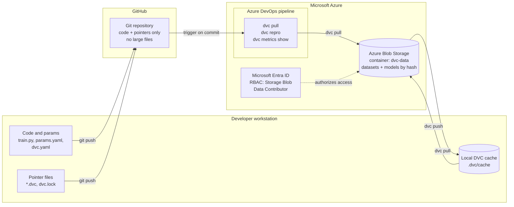
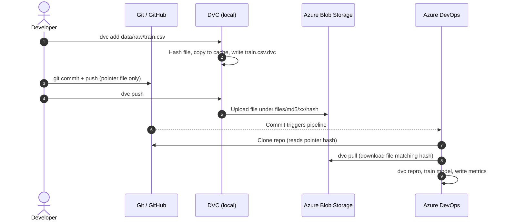
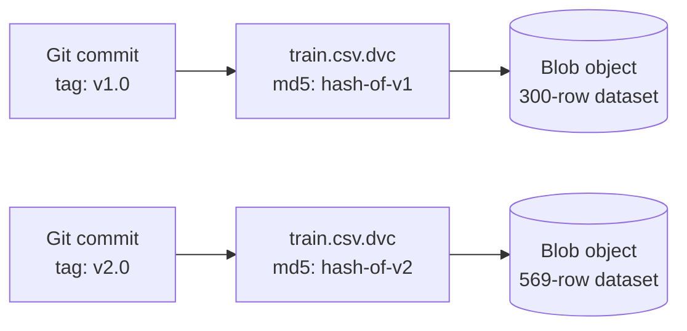
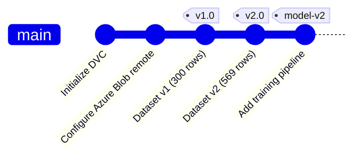
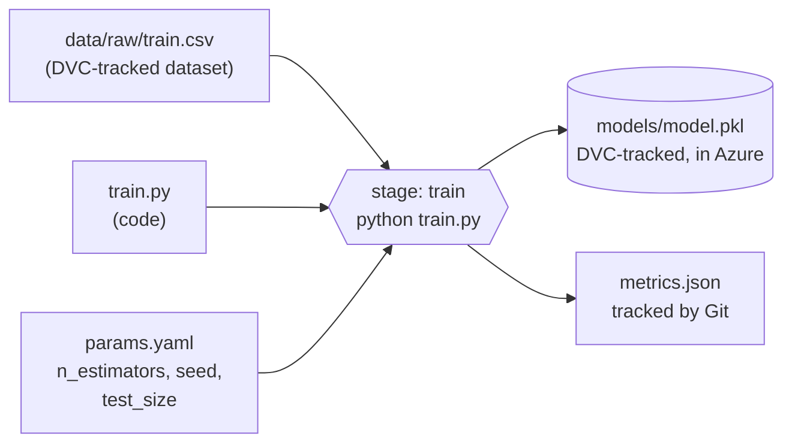
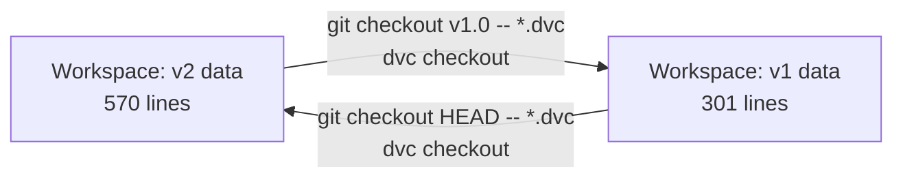
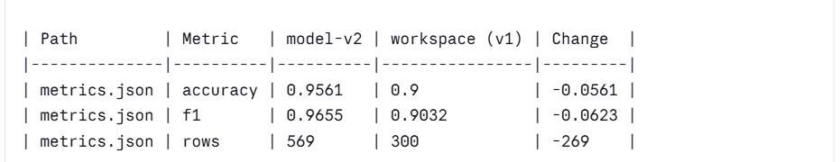
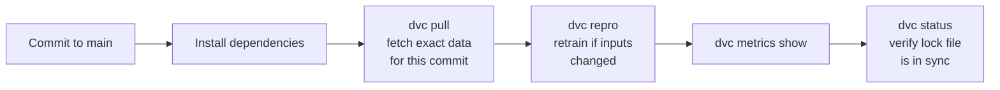
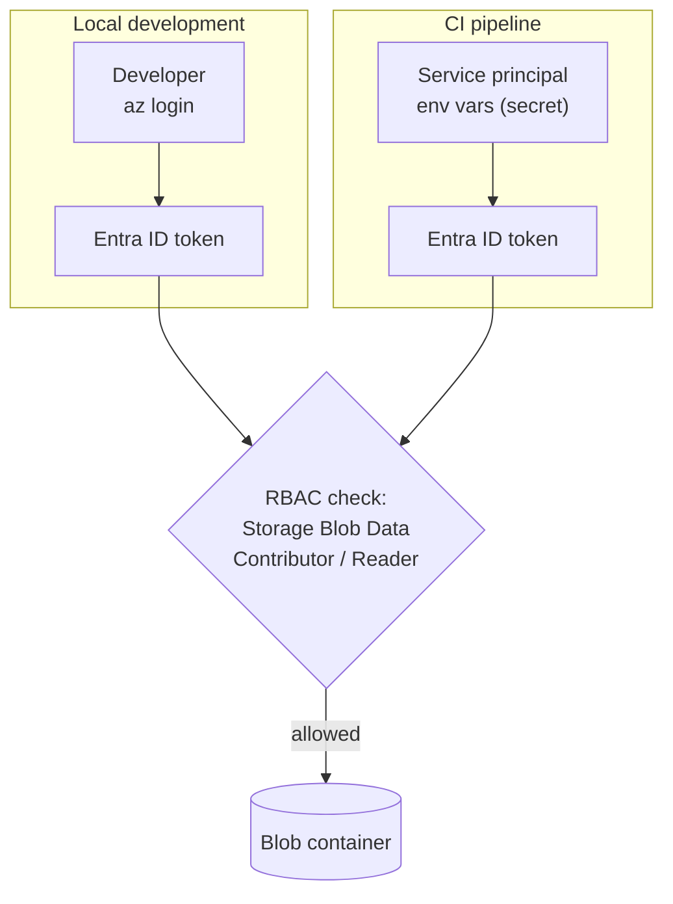

# MLOps: Data Versioning & Reproducible Training on Azure

A hands-on, production-minded reference project showing how to **version datasets and models with [DVC](https://dvc.org)**, store them in **Azure Blob Storage**, tie every trained model to the exact **code + data + parameters** that produced it, and **reproduce training automatically in Azure DevOps**.

> **One-line summary:** Git versions the code, DVC versions the data, Azure Blob stores the bytes, and a single Git commit links them all together, so any model can be reproduced and audited.

---

## Table of contents

1. [Why this project exists](#1-why-this-project-exists)
2. [Core concepts](#2-core-concepts)
3. [Architecture](#3-architecture)
4. [How versioning works](#4-how-versioning-works)
5. [The training pipeline](#5-the-training-pipeline)
6. [Repository structure](#6-repository-structure)
7. [Prerequisites](#7-prerequisites)
8. [Step-by-step setup](#8-step-by-step-setup)
9. [Working with data versions](#9-working-with-data-versions)
10. [Rollback demo](#10-rollback-demo)
11. [Reproducible pipeline & metrics comparison](#11-reproducible-pipeline--metrics-comparison)
12. [CI/CD with Azure DevOps](#12-cicd-with-azure-devops)
13. [Security & authentication model](#13-security--authentication-model)
14. [Design decisions & trade-offs](#14-design-decisions--trade-offs)
15. [Troubleshooting](#15-troubleshooting)
16. [Cost & cleanup](#16-cost--cleanup)

---

## 1. Why this project exists

Machine-learning systems have three moving parts: **code**, **data**, and **models**. Git handles code well, but it cannot handle multi-gigabyte datasets or model binaries. Without a solution, teams run into problems like these:

| Problem | Consequence |
|---|---|
| Dataset overwritten in place | Nobody can tell which data a model was trained on |
| Model accuracy drops in production | Can't tell whether the cause is data drift, a code change, or a parameter change |
| Auditor asks "how was model X produced?" | No evidence trail, so compliance fails |
| New teammate or CI runner needs the data | Manual copying from someone's laptop |

This project solves them with **data version control**: large files live in cloud storage, Git stores only tiny pointer files, and every commit captures a complete, restorable snapshot of code **and** data.

### What this project demonstrates

- Initializing and configuring DVC inside a Git repository
- Versioning datasets and models in **Azure Blob Storage** (no files committed to Git)
- Switching between data versions to **roll back and roll forward**
- A **DVC pipeline** (`dvc.yaml`) with tracked dependencies, parameters, outputs and metrics
- Comparing experiments across versions with `dvc metrics diff`
- **Keyless authentication** to Azure using Microsoft Entra ID RBAC
- A **CI pipeline** in Azure DevOps that pulls versioned data and reproduces training

---

## 2. Core concepts

| Term | Meaning |
|---|---|
| **DVC pointer file** (`*.dvc`) | A tiny text file (hash, size, path) committed to Git in place of the real data |
| **Content hash (MD5)** | A fingerprint of a file's contents. Same content gives the same hash, and any change gives a new hash |
| **DVC cache** | Local folder (`.dvc/cache`) holding data files, addressed by hash |
| **DVC remote** | Shared storage (here: Azure Blob container) that holds the real data, addressed by hash |
| **`dvc add`** | Start tracking a file or folder: hash it, move it into the cache, create the pointer |
| **`dvc push` / `dvc pull`** | Upload data to / download data from the remote |
| **`dvc checkout`** | Make the working directory match the pointers currently checked out in Git |
| **Pipeline stage** | A command with declared inputs (deps, params) and outputs (outs, metrics) in `dvc.yaml` |
| **`dvc.lock`** | Records the exact hashes of every dep and output from the last pipeline run |
| **Reproducibility** | Same code + same data + same params produces the same model |

---

## 3. Architecture



**Key idea:** the Git repository stays small and fast. The heavy bytes live in Azure Blob Storage, and the only link between them is the content hash stored in the pointer files.

### Data flow sequence



---

## 4. How versioning works

Every dataset version is just **a different pointer in a different Git commit**. DVC resolves the pointer to the right object in Blob Storage.



An example pointer file (this is the only thing Git stores for the dataset):

```yaml
outs:
- md5: <content-hash>
  size: <bytes>
  hash: md5
  path: train.csv
```

**Version history of this project:**



### Rule of thumb

| Layer | Tool | Command to move forward / back |
|---|---|---|
| Pointers (small) | Git | `git checkout <tag> -- <file>.dvc` |
| Real data (large) | DVC | `dvc checkout` (local cache) or `dvc pull` (from Azure) |

---

## 5. The training pipeline

`dvc.yaml` declares the pipeline as a graph. DVC re-runs a stage **only when something it depends on has changed**.



| Stage element | Value | Tracked by |
|---|---|---|
| **deps** | `train.py`, `data/raw/train.csv` | DVC (hash) |
| **params** | `train.n_estimators`, `train.seed`, `train.test_size` | DVC (value) |
| **outs** | `models/model.pkl` | DVC, stored in Azure Blob |
| **metrics** | `metrics.json` | Git (small, diffable text) |

The model is a scikit-learn `RandomForestClassifier` trained on the breast-cancer dataset. The model itself is intentionally simple. **The point is the versioning, lineage and reproducibility around it.**

---

## 6. Repository structure

```text
MLOps/
├── README.md                    # This document
├── make_data.py                 # Creates dataset versions (N rows) for the demo
├── train.py                     # Training stage: reads data + params, writes model + metrics
├── params.yaml                  # Hyperparameters (tracked by DVC)
├── dvc.yaml                     # Pipeline definition
├── requirements.txt             # Python dependencies (dvc[azure], scikit-learn, ...)
├── pipelines/
│   └── azure-pipelines.yml      # Azure DevOps CI pipeline
├── scripts/
│   └── setup_azure.sh           # Provisions storage account, container, RBAC
└── docs/
    └── images/                  # Screenshots (Azure container, metrics diff)
```

Files created while you work through the steps below (committed to Git as small text files, with the data itself in Azure): `.dvc/config`, `.dvcignore`, `data/raw/train.csv.dvc`, `dvc.lock`, `metrics.json`.

---

## 7. Prerequisites

- An **Azure subscription** with permission to create a resource group and assign roles
- **Azure CLI** (`az`), authenticated with `az login`
- **Python 3.9+** and **Git**
- A **Bash** shell (Linux, macOS, WSL, or Git Bash on Windows)

---

## 8. Step-by-step setup

### Step 1: Clone and create a virtual environment

```bash
git clone https://github.com/<your-username>/MLOps.git
cd MLOps
python -m venv .venv
source .venv/bin/activate          # Windows: .venv\Scripts\activate
pip install -r requirements.txt
```

### Step 2: Provision the Azure remote storage

The script creates a resource group, a private storage account, a blob container, and grants **your** user the *Storage Blob Data Contributor* role.

```bash
az login
az account show                    # confirm the right subscription
./scripts/setup_azure.sh
```

Note the **storage account name** printed at the end. Blob **soft delete** (7 days) is also enabled as a safety net.

<details>
<summary>Equivalent manual commands</summary>

```bash
RG=rg-dvc-lab
LOC=centralindia
SA=dvclab$RANDOM$RANDOM            # globally unique, lowercase, 3-24 chars
CONTAINER=dvc-data

az group create -n $RG -l $LOC
az storage account create -n $SA -g $RG -l $LOC \
  --sku Standard_LRS --kind StorageV2 --allow-blob-public-access false

az role assignment create \
  --assignee $(az ad signed-in-user show --query id -o tsv) \
  --role "Storage Blob Data Contributor" \
  --scope $(az storage account show -n $SA -g $RG --query id -o tsv)

# Wait 2-5 minutes for the role to propagate, then:
az storage container create --account-name $SA -n $CONTAINER --auth-mode login
```
</details>

### Step 3: Initialize DVC

```bash
dvc init
git status                         # .dvc/ and .dvcignore are staged
git commit -m "Initialize DVC"
```

`dvc init` creates the `.dvc/` folder holding DVC's configuration and local cache.

### Step 4: Configure Azure Blob as the DVC remote

```bash
dvc remote add -d azremote azure://dvc-data/datasets
dvc remote modify azremote account_name <YOUR_STORAGE_ACCOUNT_NAME>
git add .dvc/config
git commit -m "Configure Azure Blob remote"
```

- `azure://dvc-data/datasets` means container `dvc-data`, folder prefix `datasets`.
- **No secret is stored in Git.** DVC authenticates through your `az login` session (see [Section 13](#13-security--authentication-model)).

---

## 9. Working with data versions

### Create and track dataset v1

```bash
python make_data.py 300                     # 300 rows
dvc add data/raw/train.csv                  # hash, cache, create train.csv.dvc
git add data/raw/train.csv.dvc data/raw/.gitignore
git commit -m "Add dataset v1 (300 rows)"
git tag v1.0
dvc push                                    # upload to Azure Blob
```

Inspect the pointer: `cat data/raw/train.csv.dvc`. That small file is everything Git stores about the dataset.

Verify the upload in Azure:

```bash
az storage blob list --account-name <YOUR_STORAGE_ACCOUNT_NAME> \
  -c dvc-data --prefix datasets --auth-mode login -o table
```

Objects are stored by **content hash** (for example `datasets/files/md5/ab/cdef...`), not by file name. This is expected and is what makes deduplication possible.

### Create and track dataset v2

```bash
python make_data.py 569                     # full dataset, overwrites the file
dvc status                                  # reports train.csv as modified
dvc add data/raw/train.csv                  # pointer now has a new hash
git add data/raw/train.csv.dvc
git commit -m "Add dataset v2 (569 rows)"
git tag v2.0
dvc push
```

Azure now holds **both** versions, and two Git commits point to them.

---

## 10. Rollback demo

Switch the working directory between data versions without copying a single file by hand.

```bash
wc -l data/raw/train.csv                          # 570  (569 rows + header)

# Roll back to v1
git checkout v1.0 -- data/raw/train.csv.dvc
dvc checkout data/raw/train.csv
wc -l data/raw/train.csv                          # 301  (300 rows + header)

# Roll forward to the latest
git checkout HEAD -- data/raw/train.csv.dvc
dvc checkout data/raw/train.csv
wc -l data/raw/train.csv                          # 570
```



> **Rule:** `git checkout <version>` moves the *pointer*, then `dvc checkout` moves the *data* to match.

### Simulate a new teammate or a CI machine

Delete everything local, then recover it purely from Azure:

```bash
rm -rf .dvc/cache data/raw/train.csv
dvc pull                                          # downloads from Azure Blob
```

You can also clone the repository into a fresh folder, install requirements, run `az login`, and run `dvc pull`. The data reappears, which proves the remote holds a complete, independent copy.

---

## 11. Reproducible pipeline & metrics comparison

### Run the pipeline on dataset v2

```bash
dvc repro                                         # trains on v2 data
dvc metrics show
git add dvc.yaml dvc.lock params.yaml train.py metrics.json models/.gitignore .gitignore
git commit -m "Add training pipeline, trained on v2 data"
git tag model-v2
dvc push                                          # pushes data AND the model
```

### Train on the older data and compare

```bash
git checkout v1.0 -- data/raw/train.csv.dvc
dvc checkout
dvc repro                                         # retrains because the data dependency changed
dvc metrics diff model-v2                         # compare against the tagged v2 run
```

When you are done comparing, restore the latest data:

```bash
git checkout HEAD -- data/raw/train.csv.dvc && dvc checkout
```

### Reference results

Observed when running `train.py` with the default `params.yaml` (`seed: 42`, scikit-learn 1.9.1). Your numbers should be very close, but can differ slightly across library versions.

| Dataset | Rows | Accuracy | F1 |
|---|---|---|---|
| v1 (`v1.0`) | 300 | 0.9000 | 0.9032 |
| v2 (`v2.0`, tag `model-v2`) | 569 | 0.9561 | 0.9655 |

### Example `dvc metrics diff` output

`dvc metrics diff model-v2`, run on dataset v1 (300 rows) against the v2 model:

```text
| Path         | Metric   | model-v2 | workspace (v1) | Change  |
|--------------|----------|----------|----------------|---------|
| metrics.json | accuracy | 0.9561   | 0.9            | -0.0561 |
| metrics.json | f1       | 0.9655   | 0.9032         | -0.0623 |
| metrics.json | rows     | 569      | 300            | -269    |
```



### What this proves

Every model is linked to **an exact data hash, a code version and a parameter set**. Given any commit, you can answer "what data trained this model?" and rebuild it. That is the foundation for regression debugging (data drift, model degradation) and for audit and compliance requirements.

---

## 12. CI/CD with Azure DevOps

The pipeline in [`pipelines/azure-pipelines.yml`](pipelines/azure-pipelines.yml) runs on every commit to `main`:



**Setup:**

1. Create a service principal (or use workload identity federation via an Azure DevOps service connection).
2. Grant it **Storage Blob Data Reader** (pull only) or **Contributor** (pull and push) on the storage account.
3. Add `AZURE_CLIENT_ID`, `AZURE_TENANT_ID` and `AZURE_CLIENT_SECRET` as **secret** pipeline variables. DVC's Azure authentication reads these standard environment variables.

Because the pipeline pulls data by the hash recorded in the commit, **each CI run trains on exactly the data that commit was meant to use**.

---

## 13. Security & authentication model



| Practice | Why |
|---|---|
| **Entra ID RBAC instead of account keys or connection strings** | No long-lived secrets in the repo; access can be audited and revoked per identity |
| **Public blob access disabled** | The container is never reachable anonymously |
| **Least privilege** | CI gets *Reader* if it only pulls |
| **Secrets only in pipeline secret variables** | Never committed to Git |
| **`dvc remote modify --local`** for any secret | Writes to `.dvc/config.local`, which Git ignores |
| **Soft delete on blobs** | Accidental deletes and overwrites are recoverable for 7 days |

> **Gotcha:** the *Owner* and *Contributor* roles manage the storage account but do **not** grant access to blob **data**. You need a data-plane role such as *Storage Blob Data Contributor*.

---

## 14. Design decisions & trade-offs

| Decision | Alternative | Reasoning |
|---|---|---|
| **DVC with Azure Blob** | Git LFS | DVC provides pipelines, parameters, metrics and cloud-neutral remotes. LFS only stores large files |
| **Content-addressed storage** | Folder-per-version copies | Identical files are stored once, so versions share unchanged data and storage grows only with real change |
| **Metrics in Git (`cache: false`)** | Metrics in the DVC cache | Small JSON diffs cleanly in pull requests and can be compared with `dvc metrics diff` |
| **Standard LRS storage** | GRS / ZRS | Cheapest option for a lab. Production would pick redundancy according to recovery requirements |
| **Entra ID auth** | Connection string / SAS | Keyless, auditable, and revocable |
| **Reusable setup script** | Terraform module | The script is quickest for a lab. For team use, the same resources belong in Terraform, in line with Infrastructure as Code practice |

---

## 15. Troubleshooting

| Symptom | Likely cause and fix |
|---|---|
| `AuthorizationPermissionMismatch` or HTTP 403 | The *Storage Blob Data Contributor* role is missing, or hasn't propagated yet. Wait a few minutes and retry |
| Error about missing `account_name` | Run `dvc remote modify azremote account_name <name>` |
| `dvc pull` reports missing cache | The data was never pushed. Run `dvc push` from the machine that has it |
| `dvc push` or `pull` hangs or fails after changing accounts | Run `az login` again, and confirm `az account show` points at the right subscription |
| Large file committed to Git by mistake | `git rm --cached <file>`, then `dvc add <file>` |
| A pipeline stage re-runs unexpectedly | Run `dvc status` to see which dependency, parameter or output changed |
| Need a secret for the remote | `dvc remote modify --local azremote connection_string '<value>'` (stays out of Git) |
| Cleaning up old data versions | `dvc gc -w -c` removes remote data unreferenced by the current workspace. **Destructive, so check first** |

---

## 16. Cost & cleanup

This lab stores a few megabytes in Standard LRS Blob Storage, so cost is negligible. Delete everything when you are finished:

```bash
az group delete -n rg-dvc-lab --yes --no-wait
```

---

## Author

**Sai Anil Kumar Deyyala**
